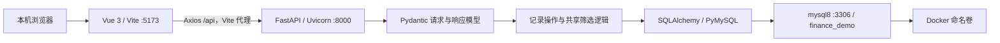

# 整体架构

版本：0.1，状态：用户已于 2026-11-16 确认。P0 / P1 已实现并通过真实 MySQL 与浏览器验收。实际范围见前后端 DELIVERY.md 与 QA 报告，接口和表结构保持已确认设计。

## 运行架构



前后端进程运行于 WSL 项目目录，MySQL 由用户在 Docker 中部署。计划前端地址 `http://localhost:5173`，后端地址 `http://127.0.0.1:8000`，接口前缀 `/api`，Swagger 地址 `/docs`。实际端口在实现时核实；后端默认绑定回环地址，不对外发布。

前端开发服务把 `/api` 代理到后端，同源调用不依赖宽泛的 CORS 放行。不添加 `allow_origins=["*"]` 作为连接问题的通用修复。前端不得获取数据库密码。

## 前端模块

| 模块 | 职责 |
| --- | --- |
| `frontend/src/App.vue` | 页面组织、筛选状态、刷新协调、新增与编辑流程 |
| `src/components/SummaryCards.vue` | 按 API 金额文本展示收入、支出和结余 |
| `src/components/TransactionForm.vue` | 新增 / 编辑、输入校验、提交状态 |
| `src/components/TransactionList.vue` | 全部记录、排序结果、编辑删除入口和空状态 |
| `src/components/FilterBar.vue` | 类型、分类、日期范围与清空筛选 |
| `src/components/ExpenseChart.vue` | P1 ECharts 分类占比及销毁、resize |
| `src/components/DeleteDialog.vue` | 删除确认、取消及结果未确认时的核对入口 |
| `src/api/client.js`、`transactions.js` | Axios 实例、统一错误与 API 调用 |
| `src/utils/money.js`、`date.js` | 十进制文本金额格式、上海日期处理 |
| `src/utils/filters.js`、`chart.js` | 筛选校验、可写字段投影及图表配置 |
| `vite.config.js` | Vue 插件、固定开发端口和 `/api` 代理 |

不引入全局状态库或路由库作为单页 Demo 的前提。前端提交原始字段名严格遵循契约。金额补零通过字符串处理，不能 `Number(amount).toFixed(2)` 后假定金额没有精度问题。推荐分类作为前端配置，API 支持自由分类文本。

首次加载、写入成功、筛选变化时重新拉取列表和 summary；协调请求版本或取消旧请求，防止快速操作后旧响应覆盖新状态。提交失败保留表单内容，成功后重置；不要把数据库失败表现为成功。图表只是展示，不作为账目计算来源。

## 后端模块

| 建议模块 | 职责 |
| --- | --- |
| `backend/app/main.py` | FastAPI 应用装配、路由、异常处理注册 |
| `app/config.py` | pydantic-settings 读取 backend/.env，校验必要设置 |
| `app/database.py` | Engine、Session、请求级会话和连接时区 / SQL 模式检查 |
| `app/models.py` | transactions ORM 模型，与 schema.sql 对齐 |
| `app/schemas.py` | Pydantic 写入 / 读取 / 统计 / 筛选模型及固定金额序列化 |
| `app/crud.py` | 共享筛选、新增、查询、编辑、删除和聚合 |
| `app/routers/` | `/transactions`、`/summary`、`/health` HTTP 路由 |
| `app/exceptions.py` | 契约要求的 422 / 404 / 503 / 500 响应 |
| `backend/tests/` | 后端开发者维护的模块和接口测试 |

采用同步 SQLAlchemy Session 和 PyMySQL。路由中同步数据库工作使用同步 `def`，避免在异步事件循环直接执行阻塞查询。每个请求独立 Session，用依赖确保关闭；写入在单个事务内执行，成功 commit 后返回，异常 rollback。

使用 SQLAlchemy URL 构造器接收分立配置，正确处理密码特殊字符，不手拼连接串、不记录带密码 URL。Engine 使用 `pool_pre_ping`，不以无限重试掩盖连接失败。MySQL 不可用时 `/api/health` 和依赖数据库的请求返回契约错误，不回退到 SQLite、JSON 文件或内存数据库。

## 数据流与精度

1. 浏览器验证表单并把金额规范化为两位小数字符串。
2. FastAPI / Pydantic 再次验证全部数据，转换 Decimal。
3. SQLAlchemy 使用参数化 SQL 写入 DECIMAL；成功提交后返回只读 ID 与 UTC 时间。
4. 前端刷新列表和 summary，显示服务器确认的数据。
5. 刷新浏览器后再次查询 MySQL，所以记录仍保留。

列表、统计、图表共享筛选范围。聚合保持 Decimal，金额输出仍是字符串。数据库创建时间存 UTC，记账日期保持原日期，两者含义不同。

## 配置、依赖与初始化

Python 依赖全部安装在根目录 `.venv/`；`backend/requirements.in` 管理直接依赖，`requirements.txt` 锁定实际版本。Vue、Axios、Vite、ECharts 仅在 `frontend/node_modules/`，保留 package 和锁文件。

环境变量沿用现有 `backend/.env.example` 的 `DB_HOST`、`DB_PORT`、`DB_NAME`、`DB_USER`、`DB_PASSWORD`。主 Agent 如需增加配置，先同步文档和模板。不得提交真实 `.env`。

管理员使用 [schema.sql](../database/schema.sql) 初始化；后端启动不自动建库或重建表。业务入口现已实现，启动命令如下；无数据库时请求会返回 503：

```bash
# 项目根目录
.venv/bin/python -m uvicorn app.main:app --app-dir backend --host 127.0.0.1 --port 8000 --reload
```

前端计划在 `frontend/` 使用 `npm run dev`，Vite 设置 `port: 5173` 和 `strictPort: true`，避免端口被占时静默换端口造成误判。

## Agent 协作与集成

主 Agent 在用户确认规划后统一派发任务。前端和后端依据同一契约并行实现，QA 可先准备可执行用例；QA 的真实端到端验收依赖前端、后端与 MySQL 均可运行。

共享工作目录使所有 Agent 能立即看到变更，因此通过文件责任边界避免互相覆盖，而不是让三个 Agent 同时操作 Git。子 Agent 不提交、不重置、不切分支，不创建后代；主 Agent 负责审查、Git 操作和契约决策。具体边界见 [TASK_BOARD.md](TASK_BOARD.md)。

项目级角色定义保存在 `.codex/agents/*.toml`，并发设置保存在 `.codex/config.toml`。采用 [OpenAI 官方 Subagents 文档](https://learn.chatgpt.com/docs/agent-configuration/subagents)当前列出的格式；并发上限 3 不含主线程，模型设置继承父会话。

本会话原生 `spawn_agent` 工具没有单独的角色选择参数。第三阶段派发时，主 Agent 将读取角色文件并把职责、禁止嵌套、写入边界、契约路径明确传入任务，不假定角色文件已经热加载或角色名称会自动触发加载。项目配置已准备不等于插件已在当前会话重新读取；必须如实区分静态检查与实际派发结果。
